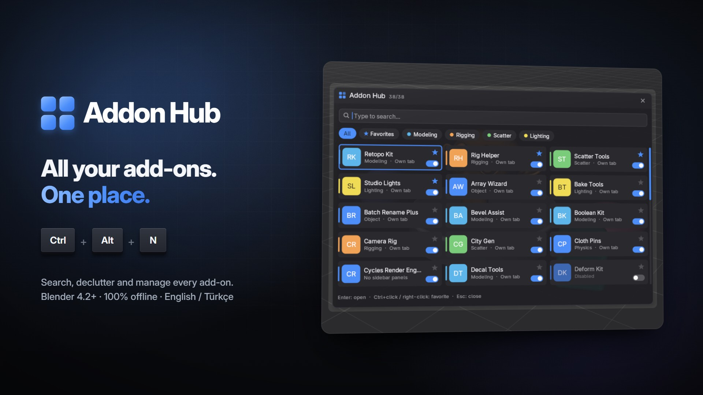

# Addon Hub – product page

Product page and documentation for the **Addon Hub** Blender add-on. This repository holds only the description, documentation and media, not the add-on itself.

- Product page: `index.html`, served with GitHub Pages at https://blenderprocedural.github.io/addon-hub/
- Documentation: `docs.html`, served at https://blenderprocedural.github.io/addon-hub/docs.html
- Images: `images/` (screenshots, before/after, cover, logo)
- Video: `media/promo.mp4` (full promo with sound) and short silent loops `media/*.mp4`
- Shared style and iframe helper: `assets/`. Fonts (Inter) are bundled in `fonts/`, so the pages make no external requests.

Both pages work inside an iframe. Links to other pages open in a new tab, and the page posts its height to the parent window (`{type: "addon-hub-height", height}`).

## Cyber Tower Generator

`cyber_tower/` holds a separate project: a Geometry Nodes generator for detailed steel-frame cyberpunk towers (add-on, demo .blend, preview images). See [cyber_tower/README.md](cyber_tower/README.md).
