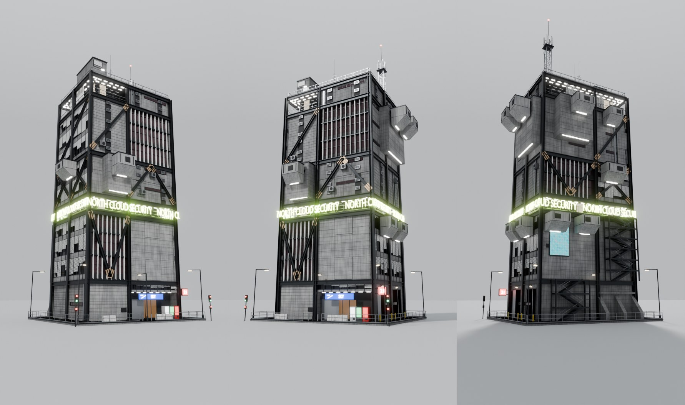
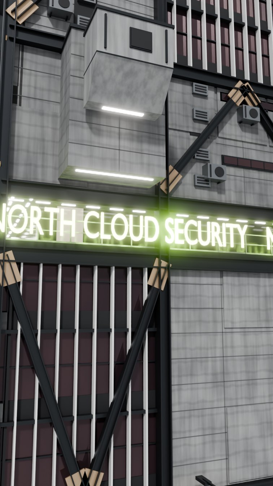
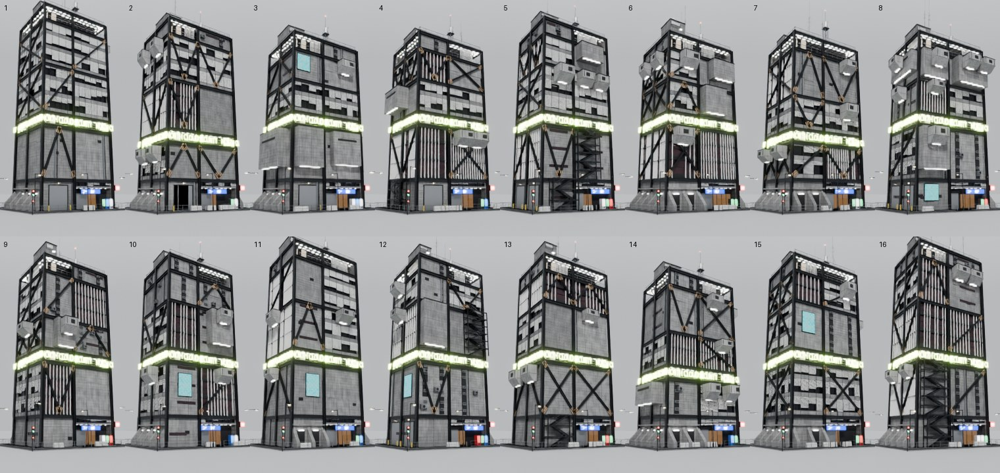

# Cyber Tower Generator (Blender Geometry Nodes)

Çelik iskeletli, brütalist / cyberpunk kuleleri tamamen **Geometry Nodes** ile üreten prosedürel bir generator. Panjur bantları, kanatlı cam cepheler, bronz guse plakalı çelik çaprazlar, asılı servis pod'ları, çıkma kütleler, kesintisiz dönen neon yazı bandı, çatı direği / antenler / çanak ve sokak elemanları tek bir modifier'dan, seed ile değişerek üretilir.





## Kurulum

**Seçenek A: hazır sahne.** `cyber_tower_demo.blend` dosyasını aç. Kule, kamera, ışık ve neon glow hazırdır. Kuleyi seç, Modifier panelinden parametreleri değiştir. Bu yolda eklenti kurmaya gerek yok, node grupları dosyanın içinde.

**Seçenek B: eklenti.**
1. `Edit > Preferences > Add-ons > Install from Disk…` ile `cyber_tower_generator.py` dosyasını seç ve etkinleştir.
2. 3D Viewport'ta `Add > Mesh > Cyber Tower`.
3. Ayarlar modifier panelinde.

Desteklenen sürümler: Blender **4.5 LTS** ve **5.x** (4.5.15 ve 5.2.3 ile test edildi). Aynı seed iki sürümde de birebir aynı binayı üretir.

## Parametreler

| Panel | Parametre | Açıklama |
|---|---|---|
| Layout | Seed | Bütün rastgele seçimleri değiştirir |
| | Width / Depth | Taban ölçüsü (m) |
| | Mass Split | Ön ve arka cephenin iki kütleye bölündüğü yer (0–1) |
| | Ground Height / Floor Height | Zemin kat ve normal kat yüksekliği |
| | Blocks | Zeminin üstünde üst üste binen cephe blokları |
| | Floors Min / Max | Blok başına kat sayısı aralığı |
| | Sign Level After | Neon bandın kaçıncı bloktan sonra geleceği (0 = yok) |
| | Sign Level Height | Neon katın yüksekliği |
| | Roof Level / Height | En üstte açık teknik kat |
| Facade Mix | Louvers, Fins, Concrete, Vents, Annex, Stair Tower | Cephe tiplerinin ağırlıkları |
| | Row Coherence | Bir sıranın tamamının aynı cephe tipini alma ihtimali |
| | Bracing / Pod / Screen Chance | Çapraz, asılı pod ve billboard ekran ihtimali |
| Structure | Column Size, Girder Depth, Brace Size | Çelik eleman ölçüleri |
| | Core Inset | Açık katlarda cam çekirdeğin içe çekilme mesafesi |
| Signage | Sign Text | Neon bant yazısı (binanın etrafında kesintisiz döner) |
| | Shop Text | Zemin kattaki dükkan tabelası |
| | Corner Sign | Köşedeki kutu tabela (boş = yok) |
| | Sign Offset | Neon yazıyı bina çevresinde kaydırır |
| Roof | Mast, Antennas, Dish, HVAC Density | Çatı ekipmanı |
| Street | Street, Street Props, Plinth Margin | Kaide, korkuluk, sokak lambası, trafik ışığı, bariyer, babalar |
| Output | Realize | Kapatınca instance olarak kalır, viewport daha hızlı olur |



## Nasıl çalışır

Kule satırlardan oluşur: zemin kat, `Blocks` kadar blok, isteğe bağlı neon katı ve isteğe bağlı açık çatı katı. Her satır altı cephe segmentine bölünür (ön ve arkada iki kütle, yanlarda birer). Her segment ağırlıklı rastgele seçimle bir cephe tipi alır. **For Each Element** zone her paneli kendi yerel uzayında kurar ve binaya yerleştirir.

| Node grubu | Görevi |
|---|---|
| `Cyber Tower` | Ana modifier grubu, bütün parametreler |
| `CT Panel` | Panel tipine göre doğru üreticiyi seçer, çapraz ve pod katmanlarını ekler |
| `CT Facade Louver` | Beton parapet bantları ve yarı inik beyaz panjurlar |
| `CT Facade Fins` | Renkli cam önünde dikey kanatlar ve kayıtlar |
| `CT Facade Concrete` | Tahta kalıp veya prekast beton, kabartma paneller, şerit pencere, menfez, kablo kanalı, billboard |
| `CT Facade Vents` | Üst üste menfez üniteli servis şaftları ve klima üniteleri |
| `CT Facade Annex` | Büyük çıkma beton kütle (üstünde pod olabilir) |
| `CT Ground Shop / Buttress / Loading`, `CT Stair` | Zemin kat: dükkan, eğimli payandalar, kepenkli yükleme kapıları, dış merdiven kafesi |
| `CT Level Sign`, `CT Level Roof` | Tavan ışıklı açık katlar, neon yazı, korkuluk |
| `CT Bracing`, `CT Pods`, `CT Pod` | X / V / chevron / zigzag çaprazlar ve guse plakaları, asılı pod'lar |
| `CT Frame` | Kolonlar, kat kirişleri, döşemeler, açık katların cam çekirdeği |
| `CT Roof`, `CT Lattice Mast`, `CT Whip Antenna`, `CT Dish`, `CT HVAC` | Çatı |
| `CT Street`, `CT Street Lamp`, `CT Traffic Light`, `CT Barrier`, `CT Blade Sign` | Çevre |
| `CT Box`, `CT Beams`, `CT I-Beam Unit`, `CT Railing`, `CT Grooves`, `CT Label`, `CT Neon Text` | Küçük yapı taşları |

Malzemeler `CT …` adıyla gelir (beton, koyu beton, çelik, bronz guse, panjur, cam, neon, ışık, ekran vb.). Shader editöründen değiştirebilirsin. Beton ve cam, panel başına `ct_rand` attribute'u ile hafif ton farkı alır.

## İpuçları

- Neon glow için Cycles'ta compositor'a Glare (Fog Glow), Eevee'de bloom kullan. Demo sahnesinde ayarlı.
- Eklentiyi güncelledikten sonra eski dosyalarda `Object > Rebuild Cyber Tower Node Groups` (veya F3 araması) node gruplarını yeniden kurar, modifier ayarlarını korur.
- Yeni bir cephe tipi eklemek için `cyber_tower_generator.py` içinde bir `build_*` fonksiyonu yaz, `BUILDERS` listesine ve `build_panel` içindeki `items` listesine ekle, `build_main` içindeki ağırlık listesine bir parametre bağla.

## Önizlemeleri ve demo dosyasını yeniden üretmek

```bash
blender -b --factory-startup --python cyber_tower/tools/make_demo.py -- \
    blend=cyber_tower/cyber_tower_demo.blend renders=cyber_tower/images seeds=9 samples=64 res=60
```

Demo dosyasını Blender 4.5 ile kaydet, böylece hem 4.5'te hem 5.x'te açılır.

---

### English summary

A fully procedural Geometry Nodes generator for detailed steel-frame brutalist / cyberpunk towers. Install `cyber_tower_generator.py` as an add-on (`Add > Mesh > Cyber Tower`) or open `cyber_tower_demo.blend`. All parameters live on the modifier: seed, footprint, block and floor counts, facade type weights, bracing / pod / screen chances, steel sizes, sign texts, roof equipment and street props. Tested with Blender 4.5 LTS and 5.2; a seed builds the same tower in both.
